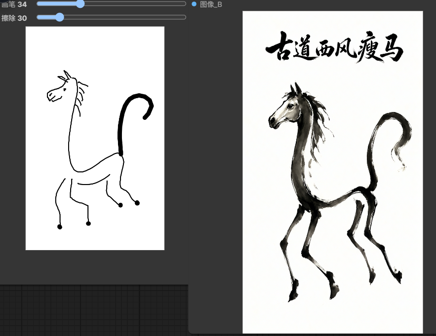
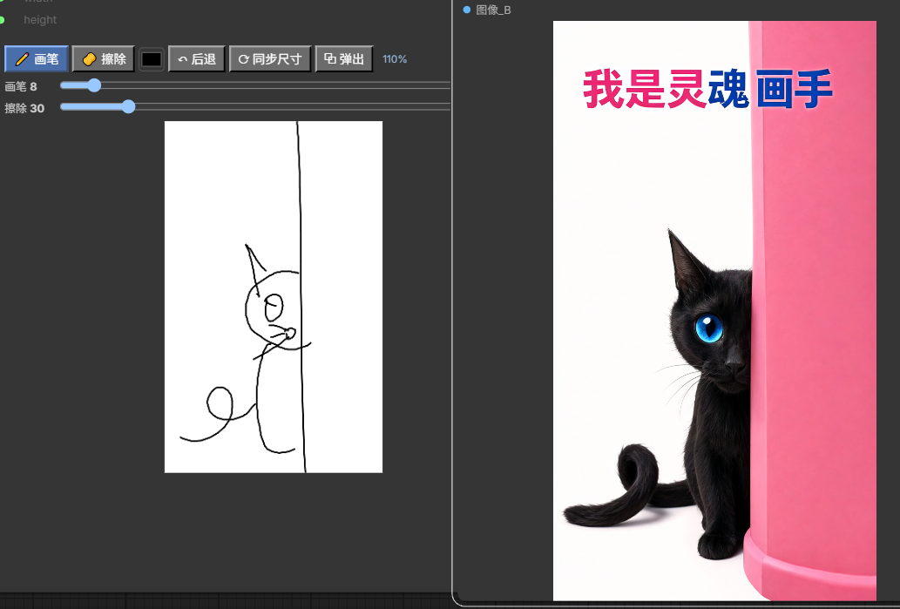
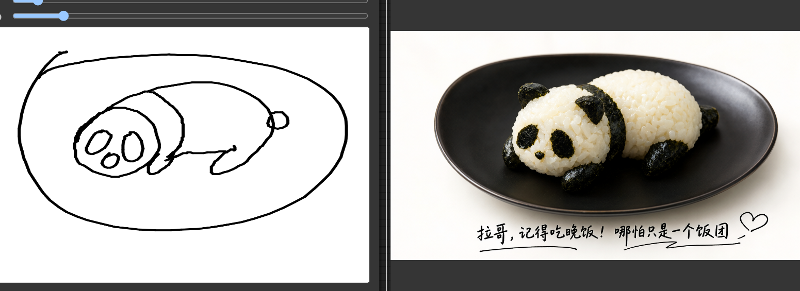
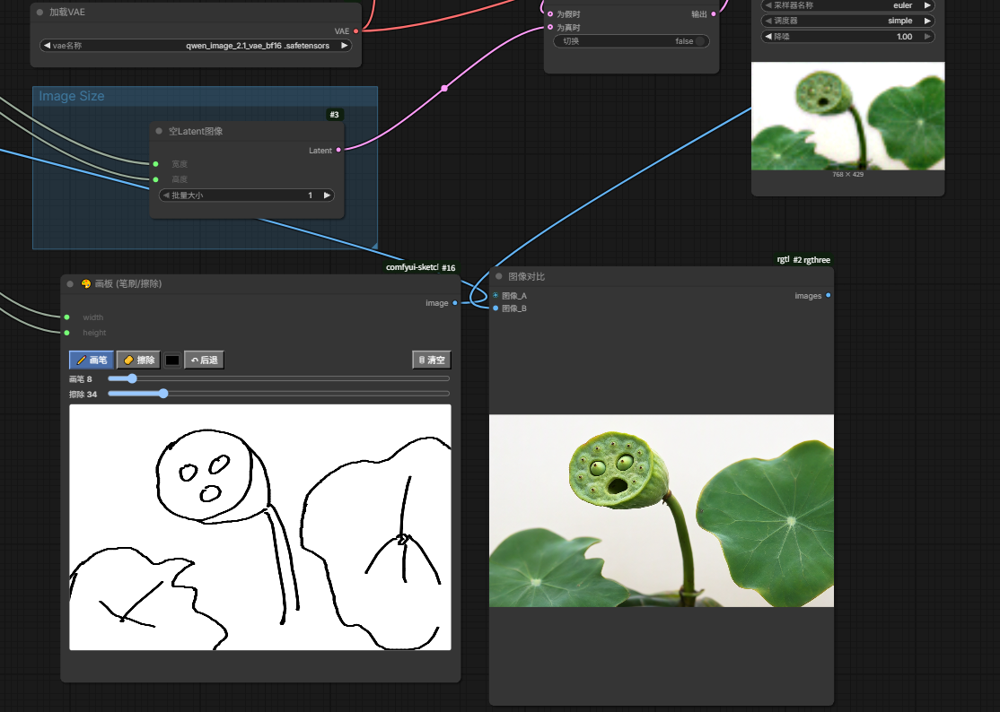

# 🎨 ComfyUI Sketchpad — 画板节点（笔刷/擦除）

一个轻量的 ComfyUI 手绘画板自定义节点：在节点里直接用画笔/橡皮画简笔草稿，输出 `IMAGE` 作为参考图（例如配合 Qwen Image / MiniMax H3 等模型的图生图或参考图工作流）。

## 🖼️ 效果展示

| 你的草稿 | AI 成品 |
|---|---|
|  | *古道西风瘦马*（Qwen Image 2.1 参考草稿生成） |
|  | *藏在柱子后面的黑猫* |
|  | *熊猫饭团* |

节点与工作流实拍：

## ✨ 功能

- **画笔 / 橡皮**：各自独立的大小滑块（画笔 1–120，橡皮 4–200），带实时笔刷大小预览圈，落笔位置与预览严格重合（任何界面缩放下都不偏移）
- **💧 压感**：开启后用数位笔/触控笔的轻重实时控制粗细（仅笔有效，鼠标不受影响）；关闭则始终用滑块固定粗细。压力直接"烤"进像素，后端出图原样保留
- **自动平滑**：手绘线条默认即用中点二次曲线拟合，天生圆顺，无需开关（不再提供关闭选项，避免生硬折线）
- **📏 直线**：直线模式，按住拖拽即画出「起点 → 当前点」的直线并实时预览，适合画直边、边框、建筑透视线
- **🔄 修形**：智能形状修正（全自动）——随手圈一个闭合的圈，松手自动用傅里叶轮廓平滑：**不区分圆/椭圆**，画得圆自然修成圆，鸡蛋保留鸡蛋的整体轮廓，只抹平手绘抖动；不像闭合环则原样保留，不会误删
- **↶ 后退 / Ctrl+Z**：最多撤销 10 步（每落笔/清空记一步）；也支持键盘 `Ctrl+Z`（Mac 为 `Cmd+Z`），仅当指针/焦点在画板区域内时触发，不会与 ComfyUI 画布自身的撤销冲突
- **⟳ 同步尺寸**：一键读取相连的「分辨率选择器」（ComfyUI 核心 `ResolutionSelector`）参数，前端直接复算目标尺寸并适配画板，**无需运行工作流**
- **⧉ 弹出**：画板可脱离节点变成独立浮动窗口——标题栏拖动移动、右下角缩放、画布随滚轮放大到 8 倍，方便精细作画
- **滚轮缩放 + 空格/中键平移**：仅影响视图，不影响出图分辨率
- **比例保护**：节点拖拽、画布适配时均为**等比缩放 + 居中留白**，画稿形状永不变形
- **分辨率跟随**：把 `width` / `height` 转为输入并连接分辨率选择器，运行一次工作流后画板自动跟随（后端通过 `ui` 通道回传实际宽高）
- **自动保存**：画布内容随工作流保存/恢复

## 📦 安装

方式一（推荐，git clone）：

```bash
cd ComfyUI/custom_nodes
git clone https://github.com/Jun812168-PNG/comfyui-sketchpad.git
```

方式二：下载 ZIP 解压到 `ComfyUI/custom_nodes/comfyui-sketchpad/`。

无任何额外 Python 依赖（torch / numpy / PIL 均为 ComfyUI 自带）。安装后重启 ComfyUI，节点在 **image/sketchpad** 分类下，名称「🎨 画板 (笔刷/擦除)」。

## 🚀 快速上手

1. 添加「画板」节点，用画笔画一个简笔草稿；
2. （可选）把 `width` / `height` 转成输入，连接「分辨率选择器」，点「⟳ 同步尺寸」让画板先适配目标比例，再动笔；
3. 将画板 `image` 输出连接到 Qwen Image 等节点的参考图输入；
4. 在提示词里描述"把这张草稿变成……"，即可按你的构图出图。

## 🧩 工作原理

- 前端 `web/sketchpad.js`：基于 Canvas 的绘制界面，兼容新版 ComfyUI 前端的 `addDOMWidget` `getValue`/`setValue` 接口（老式直接赋值 `widget.value` 在前端 1.55+ 会被静默丢弃——这是本插件踩过并修复的坑）；
- 后端 `sketchpad.py`：接收 dataURL 图像 → 等比缩放居中 → 输出 `[1, H, W, 3]` float 张量，同时把实际宽高经 `ui` 通道推回前端实现"跑一次即跟随分辨率"。

## 📄 许可证

[MIT](LICENSE)
